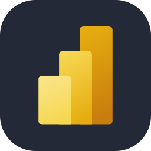
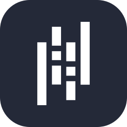
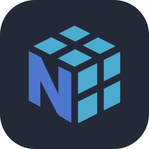
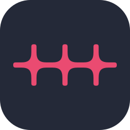
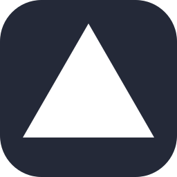
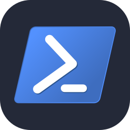
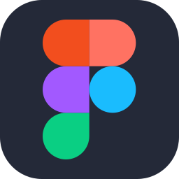
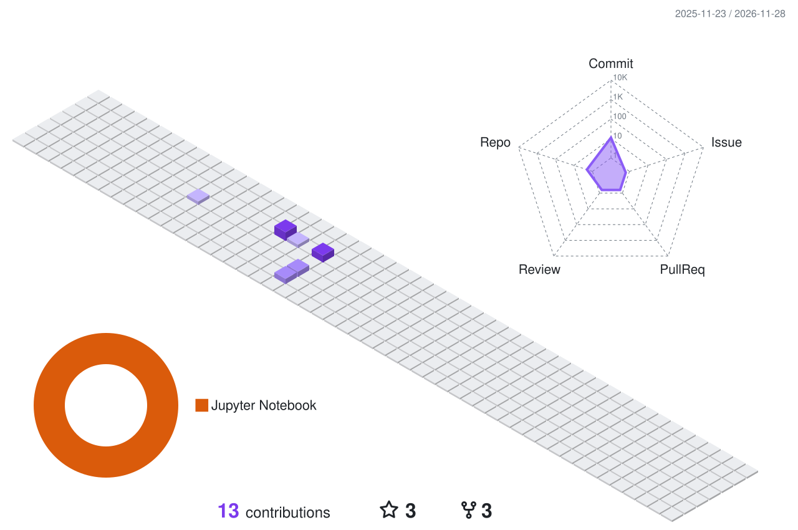

  

  

    

  &nbsp;
  &nbsp;
  

    

  

 

##  Sobre mim

Sou estudante de **Desenvolvimento de Software Multiplataforma** na **Fatec Matão** e atuo como estagiário de TI em uma empresa B2B de produtos de higiene e limpeza profissional, onde trabalho com **dashboards em Power BI**, **automações com n8n**, **manutenção de sites WordPress** e **suporte de TI**.

Gosto de entender o problema de verdade antes de escrever a primeira linha de código, e de entregar algo que funcione no dia a dia de quem usa.

##  Stack

**Linguagens e front-end**

  
  
  
  
  
  
  

**Dados e BI**

  
  
  

**Automação, back-end e web**

  
  
  
  
  
  

**Ferramentas**

  
  
  
  
  

##  Soft skills

  
  
  
  

##  Idiomas

##  Atividade no GitHub

  <!-- Gráfico 3D: reativar quando as contribuições privadas estiverem sendo contadas
  
    
  -->

  <picture>
    <source media="(prefers-color-scheme: dark)" srcset="https://raw.githubusercontent.com/RamonSantos10/RamonSantos10/output/github-contribution-grid-snake-dark.svg">
    <source media="(prefers-color-scheme: light)" srcset="https://raw.githubusercontent.com/RamonSantos10/RamonSantos10/output/github-contribution-grid-snake.svg">
    
  </picture>

    

  

